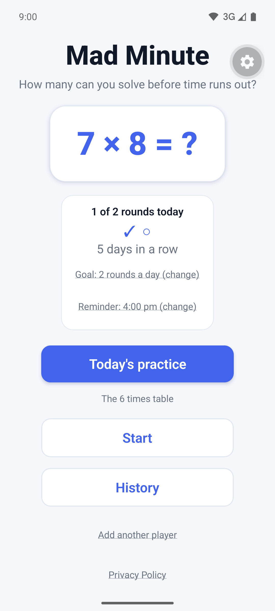
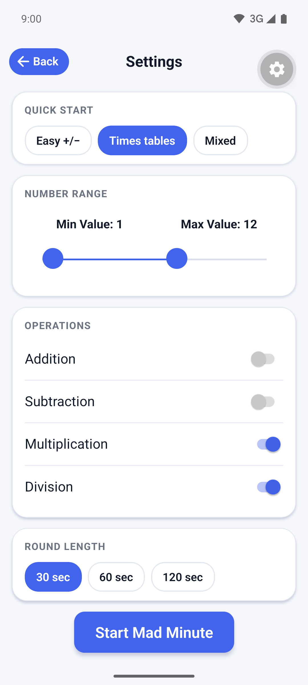
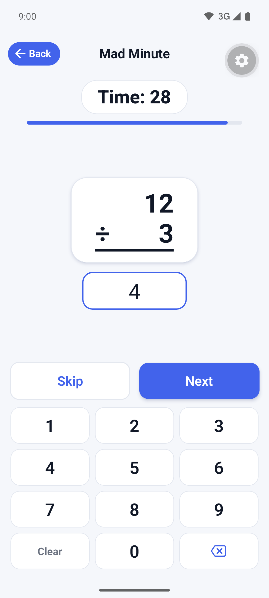
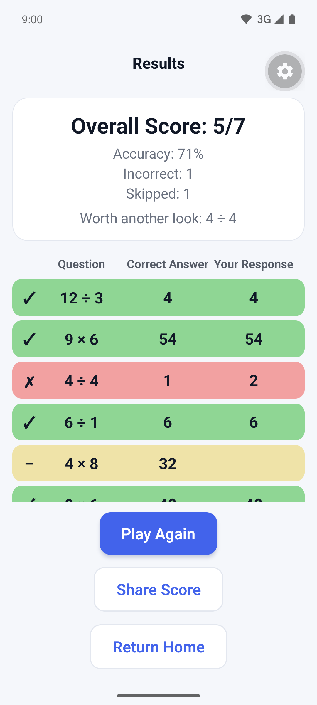
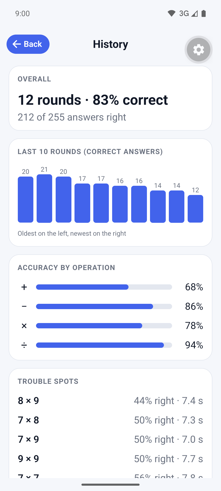
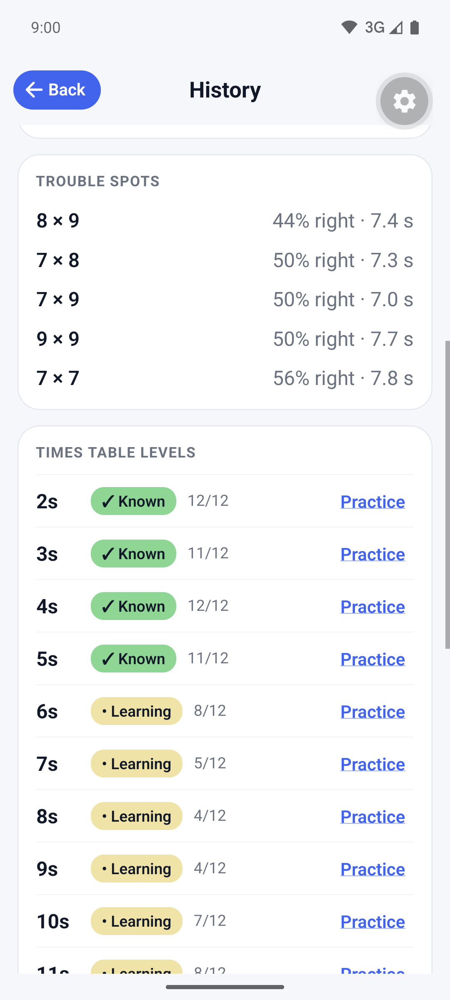
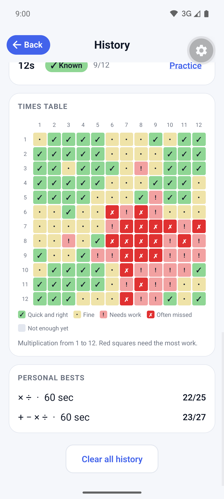
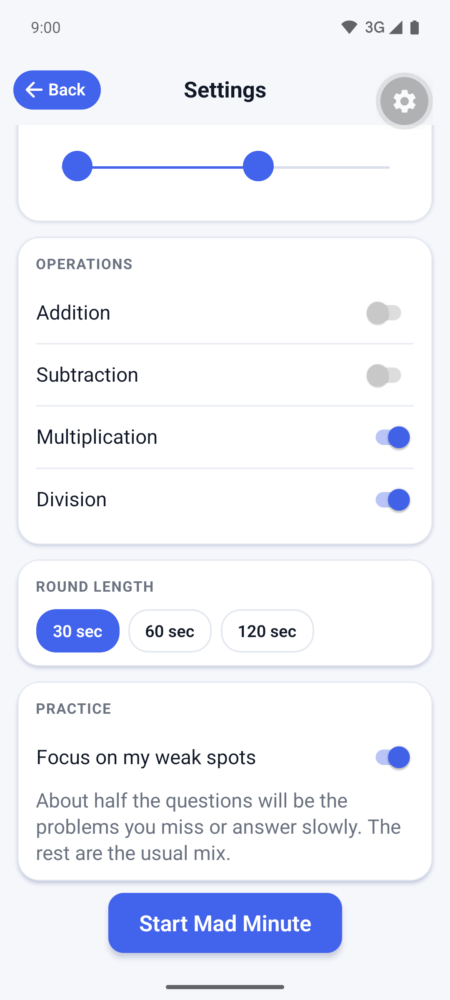
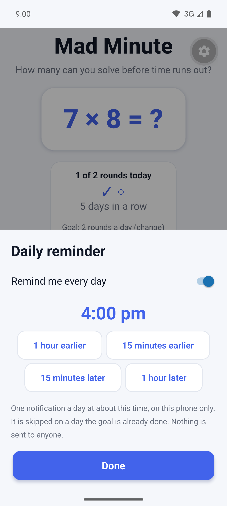

# Math Mad Minute

Mobile app for the classic "mad minute" arithmetic drill: answer as many math problems as you can in 30, 60 or 120 seconds, then see how you did. You choose which operations to practise and the range of numbers, or let **Today's practice** pick the next times table to work on.

<p>   </p>
<p>   </p>
<p></p>

## Why it exists

A timed arithmetic drill is slow to set up by hand: someone has to write the questions, time the minute and mark the answers. This app generates questions from the operations and number range you choose, runs the 60-second timer, and shows a review of every question afterwards.

## How it works

1. **Settings** – start from a quick preset (Easy +/−, Times tables, Mixed) or set it up yourself: turn addition, subtraction, multiplication and division on or off, set the smallest and largest numbers with a two-handle slider (defaults: addition only, 0 to 20), and pick a 30, 60 or 120 second round. Once you have answered 50 questions, a **Focus on my weak spots** switch (off by default) makes about half the questions your trouble spots, within the range and operations you chose.
2. **Play** – a 3-second countdown, then your chosen round length (60 seconds by default). Questions are generated from your settings; tap in an answer on the built-in number pad and submit to get the next one.
3. **Results** – correct, incorrect and skipped counts, an overall score such as `18/22`, a review of each question, and a "New personal best!" badge (with your previous best) when you beat your earlier score for the same operations and round length. If you missed any problems, it names up to three as "Worth another look".
4. **History** – opened from the home screen: your overall accuracy, a bar chart of your last 10 rounds, accuracy for each operation, **trouble spots** (the five problems you miss or answer slowly, such as 7 × 8, with how often you get them right and your average time), a **level for each times table** from 2s to 12s with a **Practice** button for each, a **times table** grid from 1 × 1 to 12 × 12 coloured by how well you know each fact, and your best score for each setup, with a button to clear it all. The app keeps a small record of every problem you have answered, on your device only, to build these.
5. **Practice path** – once you have finished a round, the home screen shows a gentle **daily goal** (1, 2 or 3 rounds, tap to change), the **streak** of days in a row with one built-in **rest day** a week (a missed day is never called a loss), and **Today's practice**: one tap starts a round of the next times table to work on (one you have started and not yet learned, otherwise the next new one, 2s, 5s, 10s, 3s and so on; players who do not practise multiplication get their own setup back). A table has one of four levels: not started, learning, known (9 of its 12 facts solid) or mastered (every fact asked three times and answered well), always shown in words and a mark, and the results screen says when a round took a table up ("You know your 7s now!"). An optional **daily reminder** (off by default, a time you choose, a notification on the device only) is skipped on a day the goal is already done.
6. **Players and backups** – the player chip on the home screen opens a sheet where you can add up to 12 players on one device (each gets a name from a fixed list of words and animals, such as "Swift Fox", so no names are typed). Each player has their own settings, history and personal bests. **Back up progress** copies a player's progress as text through the share sheet, and **Restore progress** pastes it back in as a new player, so progress can move to a new phone. A backup carries the goal and streak too, and an older backup still restores. Nothing leaves the device unless you share it.
7. **Accessibility** – buttons, the number pad and the timer are labelled for screen readers (TalkBack and VoiceOver), results and the times table use marks, words and patterns as well as colour, and the screens scroll and reflow at the largest system font size.

## Website and growth

`docs/` is the website (GitHub Pages, https://bsav0016.github.io/MadMinute/): the privacy policy, a home page 30 free printable mad minute worksheets with answer keys (`docs/worksheets/`), and more resources under `docs/resources/`: a worksheet maker, a multiplication chart, a page for each times table, a progress tracker and a guide to running a mad minute. All are generated by `node scripts/build-worksheets.js`, and tests fail if they drift from the generator or any answer is wrong. Store links are tagged per page so installs can be told apart in App Store Connect; see [docs/GROWTH.md](docs/GROWTH.md). Proposed App Store listing text is in [docs/store-listing.md](docs/store-listing.md).

## Stack

- React Native 0.88 / Expo SDK 58, React 19, TypeScript 6, Expo Router (needs Node 22.13 or newer)
- React context for the game state (`contexts/MadMinuteContext`)

## Running it

```bash
npm install
npm start            # expo start
npm run android      # or npm run ios / npm run web
npm test             # jest --watchAll
npm run test:ci      # jest --ci (single run)
npm run typecheck    # tsc --noEmit
npm run lint         # expo lint
```

`.github/workflows/ci.yml` runs the type check, lint, tests and a JavaScript bundle on every pull request. Store builds stay manual.

The app has no ads and does no tracking.

### Regenerating the screenshots

The images in `docs/screenshots/` are captured from an Android emulator by a script, so a refresh is a couple of commands. With an emulator running and Expo Go installed on it:

```bash
npx expo start --port 8081           # in one terminal
cd scripts/screenshots && npm ci     # once
node capture.mjs                     # in another; METRO_PORT, ANDROID_SERIAL and ANDROID_HOME if needed
```

It opens the app in Expo Go, turns on Android demo mode for a clean status bar, plays a 30-second round (five right answers, one wrong, one skipped) and saves the four images at the emulator's resolution (1080x2400 on a Pixel 8).

More images (History, the table levels, the times table, the reminder sheet, the goal card on the home screen and the focus switch in Settings) need saved data, so they are only taken with `SEEDED=1`. To make that data, run `node scripts/screenshots/make-seed.mjs`, which writes a made-up player to `storage/seed.local.json` (git-ignored). The app does not read that file by itself: for the capture, temporarily make `loadStored` in `storage/storage.ts` fall back to `require("./seed.local.json")[key]` (writing it to AsyncStorage) when nothing is saved for a key, clear Expo Go's data so the capture starts from the seed alone, then run `SEEDED=1 node capture.mjs` and undo the change. Buttons are found through `uiautomator`; the question during the round is read with OCR (`tesseract.js`, which downloads its English model on first run) because `uiautomator` cannot dump the screen while the timer is running. The script has its own `package.json` so the app does not depend on it.

## Design decisions

- **Timer based on elapsed time**, not on counting ticks, so the round length stays accurate if the app is briefly delayed.
- **Questions and settings as small classes** (`MadMinuteQuestion`, `MadMinuteSettings`, `MadMinuteOperator`) kept in a context, so the settings, play and results screens share one source of truth.
- **No backend or account**: everything runs on the device. Your settings and a small summary of each finished round (the last 200; no questions) are saved with AsyncStorage, and nothing is sent anywhere.
- **Saved data is versioned and validated**: values are stored as `{ v, data }`, and anything corrupt or out of range is ignored instead of crashing the app. Each round gets an id, so the results screen can only save it once.
- **Personal bests are per setup**: a best is kept for each mix of operations and round length (the number range is ignored), ranked by correct answers and then accuracy. A round of one times table has its own bests.
- **The practice path is pure functions of data the app already keeps** (`contexts/MadMinuteContext/practice.ts`): table levels come from the per-problem record, the streak and goal from one small per-player record. Days are the device's local calendar days, counted so a daylight saving change cannot add or remove a day; a clock set back never takes a streak away, and a last day more than a week ahead is treated as a wrong clock. The rest day is one per calendar week and is lazy: it is only used up when the next round is finished.
- **Calm by design for a children's app**: no points, no leaderboards, no loss wording, no message when a streak runs out, and the reminder is opt-in, local, says only "Ready for a minute of math practice?", and names no one.
- **A round of one table is not a setting**: `MadMinuteClass.table` limits the questions without touching the player's own settings, so Start still opens their usual setup.
- **Reminders are scheduled a week at a time**, not as one repeating notification, so today's can be skipped when the goal is done and a phone nobody opens stops reminding by itself (`contexts/MadMinuteContext/reminder.ts`, `notifications.ts`). `expo-notifications` is only loaded when a reminder is first turned on. They are best effort: Android may deliver one a few minutes late, because exact alarms need a restricted permission.

## Limitations

- Tests cover question generation (operators, ranges, subtraction and division edge cases), the results tally (correct, incorrect and skipped, and why the unanswered last question is not counted), the settings presets and operator display symbols, saving and loading settings (including focus mode), the weak-spot draw in focus mode (which facts qualify, the 50% mix, the settings switch), building and capping round records (including saving a round only once), personal bests, the history statistics, the per-problem record (keys, decay, weakness, validated storage, recording once per round and clearing with the history), answer timing and the no-repeat rule, the History screen's trouble spots and times table, and the results screen's "Worth another look" note. The number pad, the play screen and the settings screen's focus switch have their own tests. The practice path has tests for the day and streak rules (rest day once a week, midnight, month and year ends, daylight saving, clocks set back and far forward, corrupt saved data, checked in several time zones), the table levels and the one-table round, the goal card, Today's practice and the table level rows on the home and History screens, the level-up line on the results screen, backup and restore of the goal and streak (including version 1 backups), and the reminder (which days are scheduled, permission, saving, rescheduling, the notification wrapper and the sheet).
- The mastery thresholds (a fact is solid below a weakness of 0.15; a table is known at 9 of 12 solid facts and mastered at 3 attempts each) are reasoned guesses that have not been tuned on real play, and the app has no analytics by design, so tuning means someone watching a child play.
- Reminders were checked on an Android emulator in Expo Go (the permission prompt, scheduling and a delivered notification) but not on an iPhone or in a store build, and Google Play's Families policy and Apple's Kids rules for streak and reminder features have not been checked against this app.
- A device with several players shares one reminder, and today's is skipped when the player who is active has finished their goal.

## License

MIT. See [LICENSE](LICENSE).
