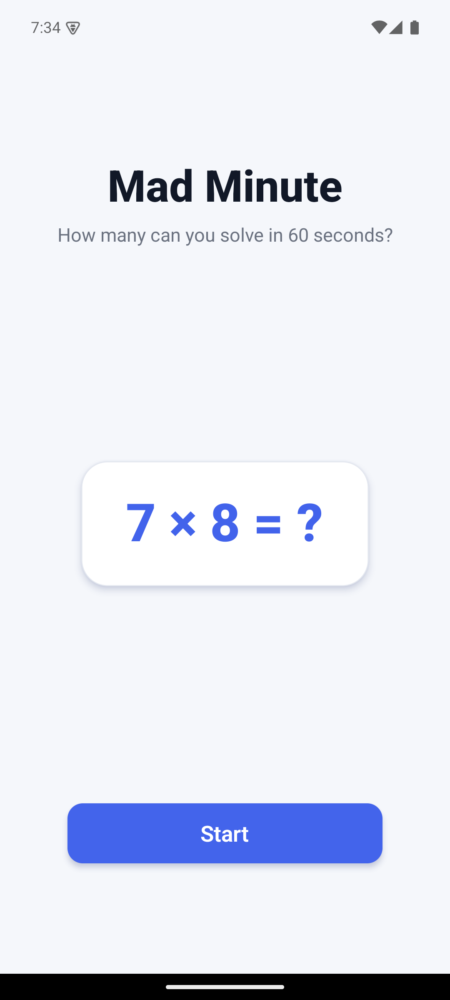
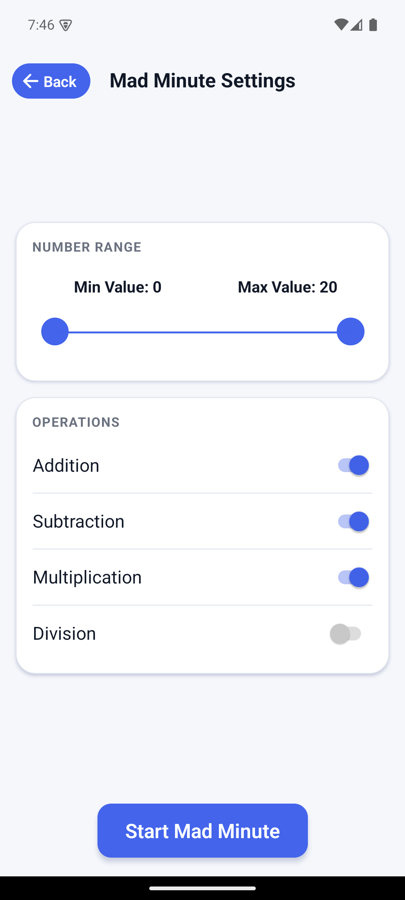
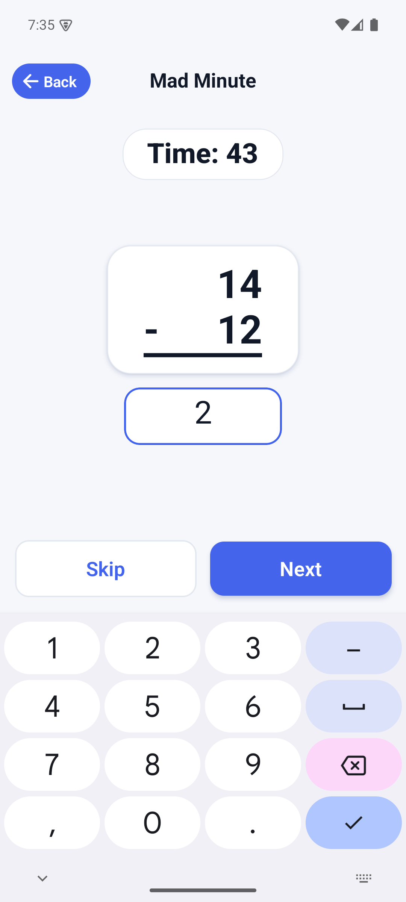
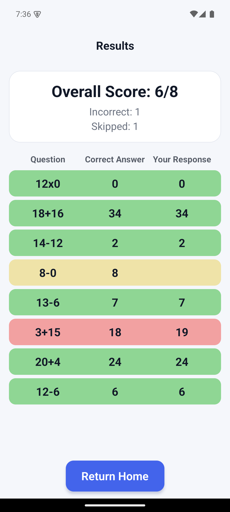

# Math Mad Minute

Mobile app for the classic "mad minute" arithmetic drill: answer as many math problems as you can in 60 seconds, then see how you did. You choose which operations to practise and the range of numbers.

<p>   </p>

## Why it exists

<!-- TODO: in your own words, why you built it (a child's practice? a classroom? learning Expo?) -->

## How it works

1. **Settings** – turn addition, subtraction, multiplication and division on or off, and set the smallest and largest numbers with a two-handle slider (defaults: addition only, 0 to 20).
2. **Play** – a 3-second countdown, then 60 seconds. Questions are generated from your settings; type an answer and submit to get the next one.
3. **Results** – correct, incorrect and skipped counts, an overall score such as `18/22`, and a review of each question.

## Stack

- React Native 0.76 / Expo SDK 52, TypeScript, Expo Router
- React context for the game state (`contexts/MadMinuteContext`)
- `react-native-google-mobile-ads` and `expo-tracking-transparency` for an ad banner (set up, but not wired into the screens yet)

## Running it

```bash
npm install
npm start            # expo start
npm run android      # or npm run ios / npm run web
npm test             # jest --watchAll
```

The ad dependencies need a native build (`npm run android` / `npm run ios`) rather than Expo Go. `app.json` still contains a placeholder Android AdMob app ID; replace it with your own before building for Android.

## Design decisions

- **Timer based on elapsed time**, not on counting ticks, so the 60 seconds stay accurate if the app is briefly delayed.
- **Questions and settings as small classes** (`MadMinuteQuestion`, `MadMinuteSettings`, `MadMinuteOperator`) kept in a context, so the settings, play and results screens share one source of truth.
- **No backend or account**: everything runs on the device.

## Limitations

- Only a template snapshot test exists; the question generation and scoring are untested.
- The banner ad provider (`contexts/BannerAdContext.tsx`) is not used by any screen yet.
- <!-- TODO: release status (is it on the App Store / Google Play?) and what you want to say about ads -->

## License

MIT. See [LICENSE](LICENSE).
